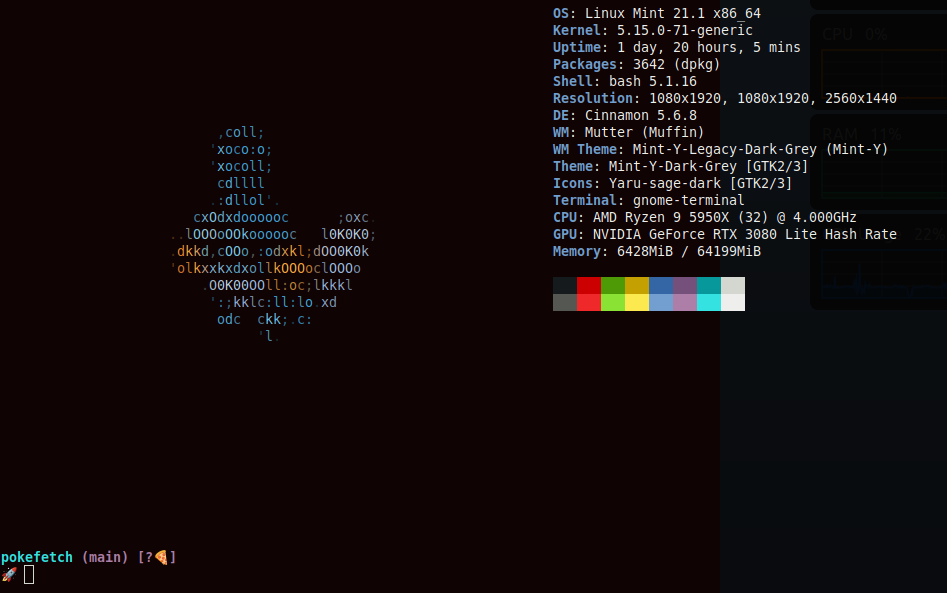
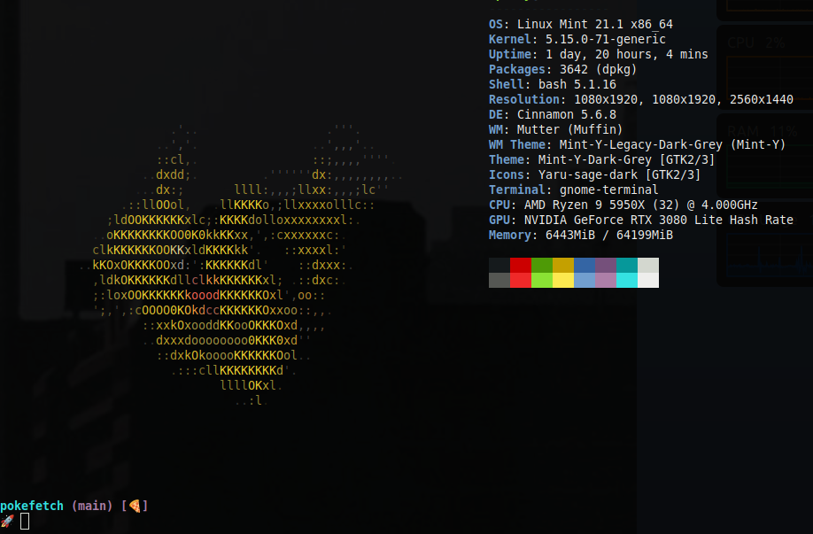

* Pokefetch

* Automated Quick Install (Recommended)

To install Pokefetch automatically:
#+begin_src bash
  ./install.sh
#+end_src

The installer will:
1. Ask whether you prefer *fastfetch* (recommended, faster) or *neofetch* (classic).
2. Check and install any missing dependencies (=jp2a=, =fastfetch=/=neofetch=, =shuf=).
3. Back up =~/.bash_functions= to =~/.bash_functions_bu= and configure the =pokefetch= function.
4. Clean previous startup messages and add the run line to the end of your =~/.bashrc=.

Non-interactive / scripted usage:
#+begin_src bash
  ./install.sh --fastfetch    # Install using fastfetch
  ./install.sh --neofetch     # Install using neofetch
  ./install.sh --uninstall    # Uninstall and revert
#+end_src

** Student Questions:
For the student that asked about this project, I forgot to mention that the colors for the text at the bottom of the terminal comes from another project called [[eww:https://starship.rs][Starship]] (https://starship.rs) I highly recommend it  

** Dependencies
- neofetch
- jp2a
- bash, shuf

** Neofetch Directory
- Contains all pokemon sprites in separate folders.
  - Pokemon:       contains all regular sprites
  - shiny:         contains the shiny ones
  - Unknown:       contains only Unknown
  - shiny_unknown: contains the shiny Unknown

* Add to bashrc script Drop in

** All pokemon with 5% shiny chance.
#+begin_src bash
  # Remember to change ~/Path/to/neofetch below to make this work as expected
  POKEFETCH_PATH=~/Path/to/neofetch
  POKE=$( [ $(( RANDOM % (101) )) -gt 95 ] && echo $POKEFETCH_PATH/shiny/`ls $POKEFETCH_PATH/shiny|shuf -n 1` || echo    $POKEFETCH_PATH/Pokemon/`ls $POKEFETCH_PATH/Pokemon|shuf -n 1`)
  neofetch --jp2a $POKE
#+end_src

** Only the Unknown with 5% shiny chance.
#+begin_src bash
  # Remember to change ~/Path/to/neofetch below to make this work as expected
  POKEFETCH_PATH=~/Path/to/neofetch
  POKE=$( [ $(( RANDOM % (101) )) -gt 95 ] && echo $POKEFETCH_PATH/shiny_unknown/`ls $POKEFETCH_PATH/shiny_unknown|shuf -n 1` || echo    $POKEFETCH_PATH/Unknown/`ls $POKEFETCH_PATH/Unknown|shuf -n 1`)
  neofetch --jp2a $POKE   --colors 10 12 0 12 15
#+end_src

* Wrapper for neofetch
#+begin_src bash
  # This is to wrap the function of Pokefetch to work a little smoother. The ability to provide the main path to images as an argument.
  # Assumes the user gives a directory that contains Pokemon/ as well as shiny/. Now you can curate your own selection to display instead of all of them. call like pokefetch /Path/to/pngs %d
  # %d as percentage of normal
  pokefetch()
  {

  POKEFETCH_PATH=$1
  NORMAL=`ls $POKEFETCH_PATH/Pokemon|shuf -n 1`
  SHINY=`ls $POKEFETCH_PATH/shiny|shuf -n 1`
     POKE=$( [ $(( RANDOM % (101) )) -gt $2 ] && echo $POKEFETCH_PATH/shiny/$SHINY || echo $POKEFETCH_PATH/Pokemon/$NORMAL)
     neofetch --jp2a $POKE --colors 10 12 0 12 15
     echo $NORMAL $SHINY

  }
#+end_src

* Another version with fastfetch

In case you do not like how slow neofetch is to populate data in some cases, you could make use of [[https://github.com/fastfetch-cli/fastfetch][fastfetch]] instead. It is faster to populate and works out just as well once you get used to the slight differences to neofetch.

#+begin_src bash
pokefetch() {

	POKEFETCH_PATH=$1
	NORMAL=$(ls $POKEFETCH_PATH/Pokemon | shuf -n 1)
	SHINY=$(ls $POKEFETCH_PATH/shiny | shuf -n 1)
	POKE=$([ $((RANDOM % (101))) -gt $2 ] && echo $POKEFETCH_PATH/shiny/$SHINY || echo $POKEFETCH_PATH/Pokemon/$NORMAL)
    # Convert image to ASCII using jp2a and store in a variable
    ASCII_ART=$(jp2a --colors --width=60 $POKE)

    # Use the ASCII art as the logo in Fastfetch
    fastfetch --data "$ASCII_ART" --logo-type data
}
#+end_src

* Examples

#+CAPTION: This is an example showing mudkip
#+NAME:   fig:mudkip example
#+ATTR_HTML: :width 150px

#+CAPTION: This is an example showing pikachu
#+NAME:   fig:pikachu example
#+ATTR_HTML: :width 150px

